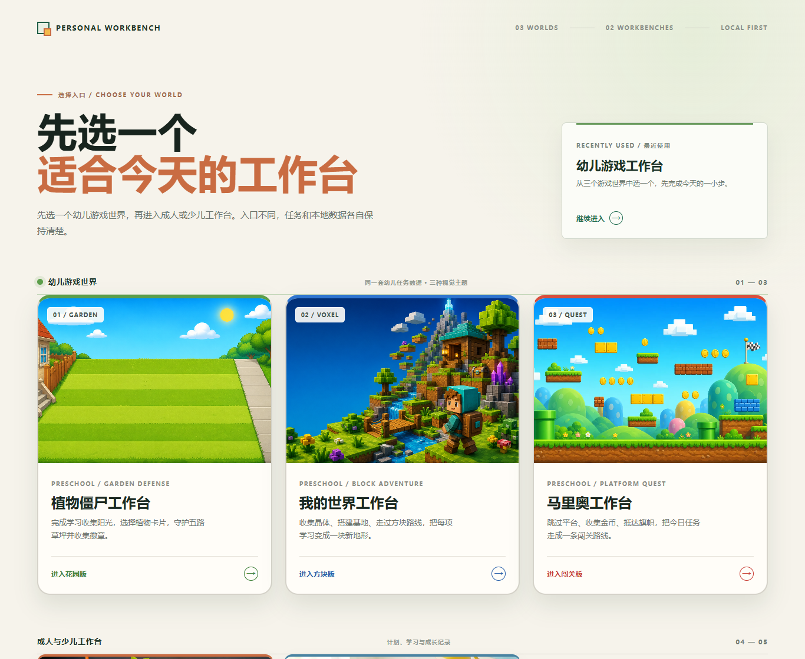
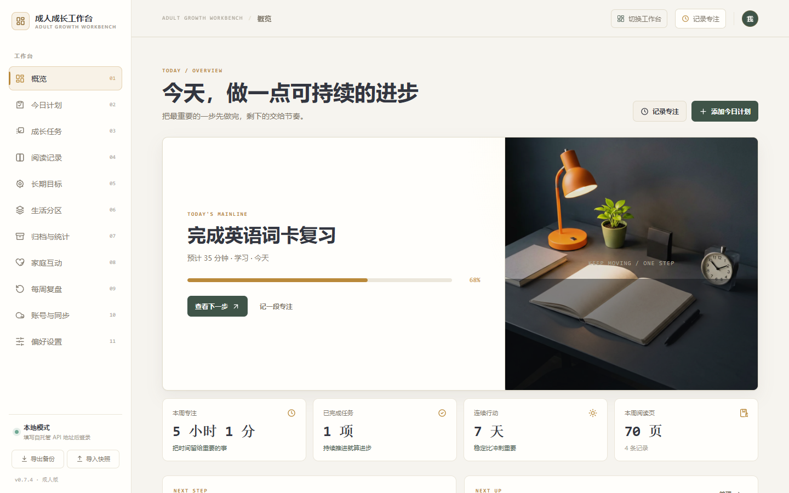
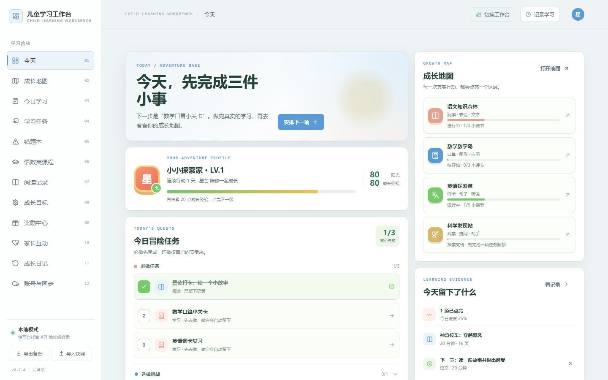
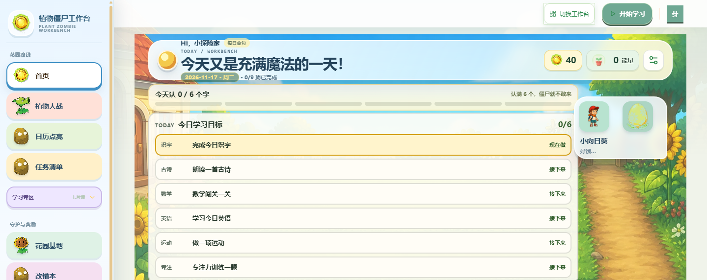

# 个人工作台

一个可以在浏览器里直接打开的中文学习与成长工作台。它把「今天先做一小步」放在前面：成人用来安排自己的计划，少儿用来记录学习和成长，幼儿则先进入一个游戏世界，再完成今天的识字、古诗、数学或英语。

页面是 Vanilla JS，不需要安装就能看。学习记录默认只保存在这台设备的浏览器里。当前版本是 `v0.7.4`。

在线入口：<https://nonomil.github.io/personal-workbench/>



上面这张图，以及后面的工作台截图，都是在空浏览器里打开内置示例时拍的，不是真实的个人记录，也不包含本机路径或账号。

## 五个入口

入口页分成两组。上面三个是幼儿游戏世界，任务和本地数据是同一套，只是外观不同。下面两个是成人和少儿工作台，数据彼此分开。

| 入口 | 适合谁 | 在线打开 |
| --- | --- | --- |
| 植物僵尸工作台 | 幼儿，花园主题 | [花园版](https://nonomil.github.io/personal-workbench/prj/preschool-workbench/?theme=garden-defense) |
| 我的世界工作台 | 幼儿，方块主题 | [方块版](https://nonomil.github.io/personal-workbench/prj/preschool-workbench/?theme=voxel-adventure) |
| 马里奥工作台 | 幼儿，横版闯关主题 | [闯关版](https://nonomil.github.io/personal-workbench/prj/preschool-workbench/?theme=platform-quest) |
| 成人成长工作台 | 自己安排今天 | [成人版](https://nonomil.github.io/personal-workbench/prj/成人成长工作台/) |
| 儿童学习工作台 | 少儿学习与成长记录 | [儿童版](https://nonomil.github.io/personal-workbench/prj/儿童学习工作台/) |

## 三个工作台

### 成人成长工作台

先看见今天最重要的一件事，再看专注时间、已完成任务、连续行动和本周阅读。侧栏里还有今日计划、成长任务、阅读记录、长期目标、生活分区、归档与统计、家庭互动、每周复盘、账号与同步、偏好设置。



### 儿童学习工作台

今天的页面把「先完成三件小事」放在最上面，旁边是成长地图和留下的学习记录。完成打卡、学习任务、课程和第一次记下阅读，可以获得阳光，再到奖励中心兑换事先说好的线下奖励。同一件事只记一次。



### 幼儿游戏工作台

字更少，按钮更大。首页只排今天的识字、古诗、数学、英语、运动和专注。阳光和能量是完成之后的反馈，没做完不会扣分。三个主题共用这一套任务。



## 在自己的电脑上打开

在仓库根目录启动一个静态服务：

```powershell
python -m http.server 7000
```

然后打开：

- <http://127.0.0.1:7000/prj/>
- <http://127.0.0.1:7000/prj/成人成长工作台/>
- <http://127.0.0.1:7000/prj/儿童学习工作台/>
- <http://127.0.0.1:7000/prj/preschool-workbench/?theme=garden-defense>
- <http://127.0.0.1:7000/prj/preschool-workbench/?theme=voxel-adventure>
- <http://127.0.0.1:7000/prj/preschool-workbench/?theme=platform-quest>

仓库根目录的 `index.html` 会跳到 `prj/`。直接双击 HTML 时，部分浏览器会限制本地存储，所以建议用上面的方式打开。

## 数据放在哪里

- 记录写在浏览器的 `localStorage` 里。成人、儿童、幼儿使用不同的 key，互不覆盖。
- 可以导出、导入 JSON 备份。备份就是当时这份本地快照，换浏览器或清除站点数据前先导出。
- 账号凭证不会写进工作台快照。如果要多设备同步，需要另外部署自托管 API，说明见 [docs/api-contract.md](docs/api-contract.md) 和 [docs/deployment.md](docs/deployment.md)。
- 页面可以放到 GitHub Pages 或 Vercel，那只是静态前端。数据库不在这个仓库里。

## Android 安装包

手机版不另写一套页面，用 Capacitor 把同一套 `prj/` 页面包成 APK。

签名证书不在仓库中。GitHub Actions 只有在仓库 Secrets 里配好下面四项后，才能打出正式签名包：

- `ANDROID_KEYSTORE_BASE64`
- `ANDROID_KEYSTORE_PASSWORD`
- `ANDROID_KEY_ALIAS`
- `ANDROID_KEY_PASSWORD`

没有这些 Secrets 时，[构建流程](https://github.com/nonomil/personal-workbench/actions/workflows/android-apk.yml) 会在签名步骤失败。推送 `main` 不会自动产出可用的签名 APK。打上 `v*` 标签并且构建成功后，才会把 APK 附加到对应的 GitHub Release。

`versionName` 跟随 `package.json`。`versionCode` 按 `主版本 × 10000 + 次版本 × 100 + 修订号` 计算，所以 `0.7.4` 对应 `704`。

本机打包需要 Node.js 22、Java 21 和 Android SDK：

```powershell
npm install
npm run android:init
npm run android:build
```

## 版本

- [v0.7.4 发布说明](docs/04-发布/v0.7.4.md)
- [v0.7.3 发布说明](docs/04-发布/v0.7.3.md)
- [v0.7.2 发布说明](docs/04-发布/v0.7.2.md)
- [v0.7.1 发布说明](docs/04-发布/v0.7.1.md)
- [v0.7.0 发布说明](docs/04-发布/v0.7.0.md)

更早的说明在 [docs/04-发布](docs/04-发布)。

## 仓库结构

- `prj/`：真正打开的页面、样式、素材和小游戏
- `docs/`：方案、课程、发布说明和本页用到的界面图
- `scripts/`、`tests/`：打包检查和测试
- `package.json`：版本号和 Android 包装脚本

产品页面集中在 `prj/`。GitHub Pages 使用 `main` 分支的根目录，打开站点后会进入 `prj/`。
