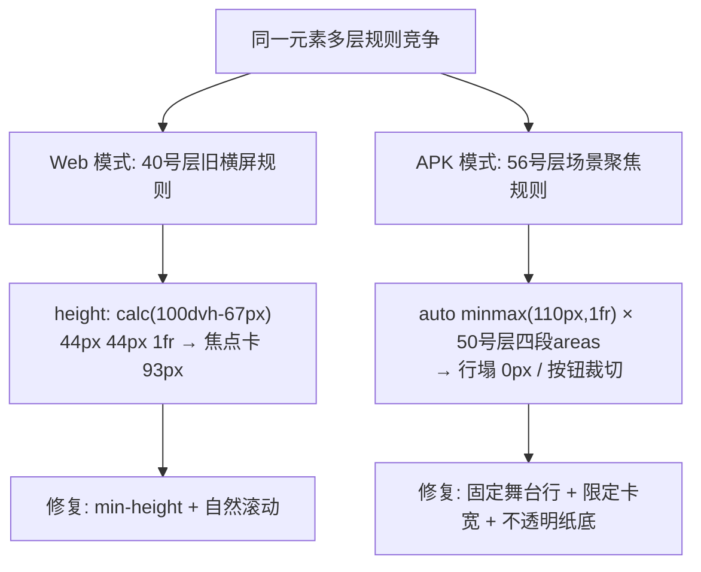

# 根因分析（本轮修复过的四类根因 + 证据）

> 均为【已验证】：每条都有浏览器复现 → 定位 → 修复 → 回归的证据链。

## R1 布局堆叠（用户最初报告"乱七八糟"）

**现象**：识字页在 800×360 下焦点卡被压成 93px、写一写行 0px、按钮悬空；
APK 模式下更糟（玻璃底卡片叠在花圃背景上不可读）。

**根因链**（规则追踪用浏览器 CSSOM 遍历 `document.styleSheets` + `el.matches` 完成）：

同类变体后来在数学/拼音/古诗页反复出现（`1fr/auto` 行分配把内容挤成细条），
最终全部收口为"**走道定高 + 内容行 minmax(0,1fr) + 卡片按内容自增**"三原则。

## R2 首页任务卡 196×76 溢出

**根因**：`home-top` 同时吃到旧 `!important height:100%`（56:363 附近）与
`justify-self:center`（56:1011 附近）→ 收缩成 fit-content 196px 宽、76px 高，
内部三段内容（目标/贴纸/任务）全部溢出到场景层。
**修法**：`width:min(400px,64vw)!important + height:auto!important + rows:auto!important` 收口。

## R3 拼音发音读成例字

两层叠加：

1. **烘焙层**：`generate-content-audio.py` 的拼音循环只取 `sample`（例字），
   63 张卡只烤了"爸/皮/…"；呼读音（波坡摸佛）、韵母本音、拼读音频不存在。
2. **代码层**：`parseBank` 拆平 `extra` 后，修复第一版读 `item.extra` 拿到 undefined，
   `|| item.sample` 静默回退例字——**修了烘焙 still 不响**，靠页面注入
   `speech.speak` 计数器才定位到。

**修法**：生成器加 `PINYIN_CALL_TEXT` 表（22 个呼读字实烤 mp3，`--dry-run`
计划 4557/4535/22 后实烤 failed=[]）；运行时呼读表 + `pinyinBlendParts` 三段；
回归锁 `doesNotMatch(item.extra)`。

## R4 场景特效被重渲染抹掉

**现象**：点"会了"有阳光 toast 但豌豆/受击/飘字全无（DOM 断言 0）。
**根因**：`commit()` → `render()` 重建整页，先挂的特效节点被丢弃。
**修法**：`setTimeout(80)` 后再 `firePreschoolScenePea`；蓄力条用
`ui.scenePeaCharge`（瞬态 UI 态）+ 发射后补 `render()` 刷新。

## R5（附带）跳转游戏变小窗

`openPreschoolWorldGame()` 拼 URL 丢 `sim-android` → 游戏页按桌面布局渲染，
`#world-canvas{max-height:min(62vh,640px)}` 在 360px 高窗口压成 ~223px。
**修法**：工作台 `<html>` 有 `is-android-app` 时 URL 追加 `&sim-android=1`。

# 解决方案总览

| 层 | 文件 | 内容 |
| --- | --- | --- |
| 布局 | `prj/css/preschool/56-phone-landscape-focus.css` | 三列战场、duo 卡左右分栏、四声条、转盘 chips、敌人/障碍动画、伙伴纵队、蓄力格（块尾追加原则） |
| 布局 | `prj/css/preschool/40-literacy-uplift.css` | web 横屏解锁滚动、四声条样式、转盘样式 |
| 逻辑 | `prj/app.js` | 呼读表/拼读/转盘/四声/抽题渲染、`renderPreschoolSceneZombieRail(course,session)` 主题敌人、`firePreschoolScenePea(defeatMode)`、`preschoolSceneSound`、`renderPreschoolTodaySunGoal`、`syncPreschoolMistakeInvasion`、mark 分支（蓄力+抑制庆祝+scene-clear+5） |
| 逻辑 | `prj/games/garden-defense/game.js` | `maybeQuizThenPlace/showDynamicQuiz/showLearningCard/doPlace`、`QUIZ_GATE_INTERVAL=5`、`quizPlantsThisStage` |
| 数据 | `prj/games/shared/literacy-quiz-bank.js` | 400 字读音三选一（生成器 `scripts/build-literacy-quiz-bank.py`） |
| 桥接 | `prj/games/shared/workbench-bridge.js` | `drawLiteracyQuiz`（mastery 分层 + 日期轮换） |
| 音频 | `prj/assets/audio/tts/pinyin/`（70 mp3）+ `tools/tts-portable/generate-content-audio.py` | 呼读音烘焙 |
| 套件 | `pinyin-pronunciation-kit/` | 独立复用包（数据/播放器/音频/脚本/README） |

# 环境信息

- OS：Windows（Git Bash 语法；python 用 `python` 命令，3.11）
- Node 22（`node --test`）；测试文件在 `tests/*.test.mjs`（regex 合同式，读源码断言）
- 本地服务：仓库根 `python -m http.server 8642 --bind 127.0.0.1`；
  file:// 协议不可用于浏览器自动化，必须走 http
- 浏览器走查：ZCode 内置浏览器（`?sim-android` + hash 路由）；
  **注意截图管线偶发抓到过渡帧/空帧**——以 DOM 断言为准，截图只做辅助
- APK：`npm run android:prepare`（prj→dist 同步，Windows 下偶发 ENOTEMPTY，
  先 `rm -rf dist` 再跑）；`npm run android:build`（gradle，本会话未执行）
- TTS：`pip install edge-tts`；VoxCPM2 权重在 `D:/HuggingFaceCache/`（未用）
