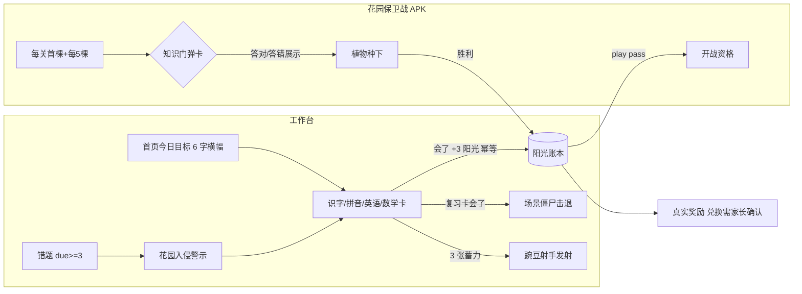

# 问题背景

工作台（幼儿版，preschool-workbench）+ 花园保卫战（garden-defense，Capacitor APK）需要形成
"多认字 = 打僵尸 = 攒阳光 = 守花园"的学习闭环。本包覆盖的会话完成了三件大事：

1. **短横屏（800×360）布局修复**：识字页/首页在纯 Web 与 APK 两种模式下元素堆叠、按钮被裁。
2. **战场学习闭环 S1~S8**（计划包 `docs/plans/T20260829-pvz-learning-loop/`）：
   场景页改成「左列伙伴纵队 / 中列学习卡 / 右列敌人纵队」三列战场，
   会了卡片触发豌豆射击+僵尸受击+阳光入账，知识门内嵌进主战斗。
3. **拼音发音与拼读修复**：发音读成例字 → 呼读音体系；补齐跟我拼三段、四声条、拼读转盘；
   并抽出独立套件 `pinyin-pronunciation-kit/`。

用户设备：Android 平板/手机横屏（CSS 视口 ~800×360，WebView 物理分辨率渲染，与"分辨率低"无关）。

# 关键发现

> 证据分层：【已验证】= 代码/浏览器实测/测试直接支持；【推测】= 解释性判断。

1. 【已验证】**布局乱的根因是 CSS 层叠合同冲突，不是分辨率**。WebView 按物理分辨率渲染，
   ~800×360 是密度归一化的 CSS 视口。40/44/47/48/50/53/56 七个 CSS 层在同视口下互相覆盖
   `grid-template-rows`，最终由 56 号层主题作用域规则胜出。修复全部收口在
   `prj/css/preschool/56-phone-landscape-focus.css`（安卓横屏 max-height:480 块）与
   `prj/css/preschool/40-literacy-uplift.css`（web 横屏块）。
2. 【已验证】**"听拼音读成例字"的根因是烘焙清单缺失 + 字段拆平**：
   `tools/tts-portable/generate-content-audio.py` 只为拼音库烤了例字（爸/皮…）；
   且 `preschool-pinyin.js parseBank` 把 `extra` 拆平成顶层字段，任何读 `item.extra`
   的代码都拿到 undefined 而静默回退。两处都已修，并有 `doesNotMatch(item.extra)` 回归锁。
3. 【已验证】**发射特效会被 commit 重渲染抹掉**：`commit()` 内部 `render()` 重建 DOM，
   同步挂载的特效节点随即消失。所有"会了→特效"必须 `setTimeout(80)` 后挂到新 DOM
   （`firePreschoolScenePea` 就是这么接的）。
4. 【已验证】**学习↔游戏权闭环本身是通的**：play pass 耗尽时游戏正确弹休息层
   "去做任务再来守"；走查时曾用它现场验证（`bridge.grantPlayPass` 可模拟学完一课补 pass）。
5. 【已验证】**打包跳过清单会吞素材**：`scripts/prepare-mobile.mjs` 的 SKIP 清单排除了
   `assets/generated/blocklegend-roster`，voxel 敌人图直接引用会真机静默消失
   （onerror hidden）。已把三张图拷进 `preschool-theme-assets/voxel-v1/published/`（随包）。
6. 【推测】**每张卡都弹"过关"模态对学习节奏有害**（用户观察 + 弹窗降级后翻卡流畅度改善），
   所以知识门定为"每关首棵 + 每 5 棵"，庆祝类弹窗在学习卡场景降级为 toast。

## 闭环架构（当前形态）

# 决策记录（全部经用户确认或授权自决）

| 决策 | 理由 |
| --- | --- |
| 拼音音频不用第三方库，自烤 edge-tts | 三个开源集许可不明（详见根因分析） |
| 敌人列三主题化：garden 僵尸 / voxel 方块怪 / platform 障碍 | 用户方案"左边一列伙伴，右边一列敌人" |
| 会了→豌豆射击+受击+阳光（+3/张，幂等） | 用户"游戏和学习结合起来" |
| 普通卡 3 张蓄 1 发；复习卡当场击退 | 用户反馈"弹窗太影响学习，学几个再发射" |
| 庆祝弹窗在翻卡场景降级 toast | 同上 |
| 知识门 = 每关首棵 + 每 5 棵；题源动态化（识字库 400 字，复习优先） | 用户"你自己决定" |
| 答错知识门仍种植物（只高亮正确答案） | 无惩罚红线 |
| 拼读转盘合法音节表移植 blocklegend legal-bases（403） | 数据可用；其音频不采用 |
| 跳转游戏 URL 追加 `sim-android=1` | 修复"进游戏变小窗"（丢环境标记走桌面布局） |
